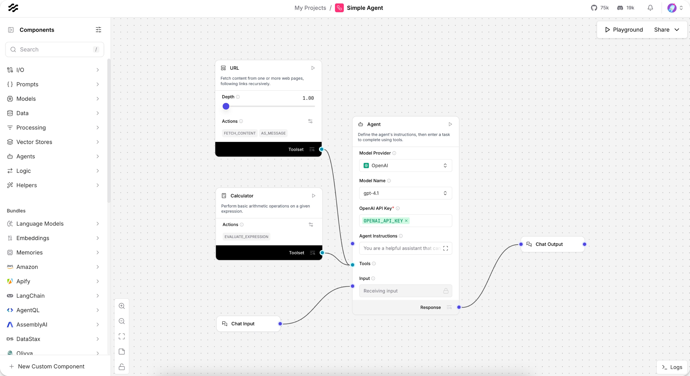
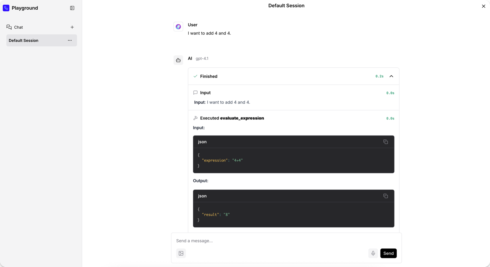

import Icon from "@site/src/components/icon";
import Tabs from '@theme/Tabs';
import TabItem from '@theme/TabItem';
import PartialGlobalModelProviders from '@site/docs/_partial-global-model-providers.mdx';

Get started with Langflow by loading a template flow, running it, and then calling it with the Workflow API at `POST /api/v2/workflows`.

## Prerequisites

- [Install and start Langflow](/get-started-installation)
- Create an [OpenAI API key](https://platform.openai.com/api-keys)
- Create a [Langflow API key](/api-keys-and-authentication)

    <details>
    <summary>Create a Langflow API key</summary>

    A Langflow API key is a user-specific token you can use with Langflow.

    To create a Langflow API key, do the following:

    1. In Langflow, click your user icon, and then select **Settings**.
    2. Click **Langflow API Keys**, and then click <Icon name="Plus" aria-hidden="true"/> **Add New**.
    3. Name your key, and then click **Create API Key**.
    4. Copy the API key and store it securely.
    5. Include your Langflow API key in the `x-api-key` header. Set `LANGFLOW_API_KEY` in the terminal where you run the request. A curl command expands `$LANGFLOW_API_KEY`. Replace `LANGFLOW_SERVER_ADDRESS` and `FLOW_ID`.
    For example:

        ```bash
        export LANGFLOW_API_KEY="sk..."

        curl -X POST "http://LANGFLOW_SERVER_ADDRESS/api/v2/workflows" \
        -H "Content-Type: application/json" \
        -H "x-api-key: $LANGFLOW_API_KEY" \
        -d '{
          "flow_id": "FLOW_ID",
          "input_value": "Hello"
        }'
        ```

    </details>

## Run the Simple Agent template flow

1. In Langflow, click **New Flow**, and then select the **Simple Agent** template.



The **Simple Agent** template consists of an [**Agent** component](/agents) connected to [**Chat Input** and **Chat Output** components](/chat-input-and-output) and a [**URL** component](/url). The **Calculator** tool is part of the **Agent** component, and it is enabled by default. When you run this flow, you submit a query to the agent through the **Chat Input** component, the agent uses its **Calculator** tool and the **URL** tool to generate a response, and then returns the response through the **Chat Output** component.

Many components can be tools for agents, including [Model Context Protocol (MCP) servers](/mcp-server). The agent decides which tools to call based on the context of a given query.

2. In the **Agent** component, click **Setup Provider** to select your language model provider.
   <PartialGlobalModelProviders />
3. In the **Agent** component, select your configured model from the **Language Model** dropdown.

4. To run the flow, click <Icon name="Play" aria-hidden="true"/> **Playground**.

5. To test the agent's **Calculator** tool, ask the agent a simple math question, such as `I want to add 4 and 4.`
To help you test and evaluate your flows, the **Playground** displays the agent's reasoning process as it analyzes the prompt, selects a tool, and then uses the tool to generate a response.
In this case, a math question causes the agent to use the **Calculator** tool and an action like `evaluate_expression`.



6. To test the **URL** tool, ask the agent about current events.
For this request, the agent selects the **URL** tool's `fetch_content` action, and then returns a summary of current news headlines.

7. When you are done testing the flow, click <Icon name="X" aria-hidden="true"/>**Close**.

:::tip Next steps
Now that you've run your first flow, try these next steps:

- Edit your **Simple Agent** flow by attaching different tools or adding more [components](/concepts-components) to the flow.
- [Build your own flows](/concepts-flows) from scratch or by modifying other template flows.
- Integrate flows into your applications, as explained in [Run your flows from external applications](#run-your-flows-from-external-applications).
:::

## Run your flows from external applications

Langflow is an IDE, but it's also a runtime you can call through the [Langflow API](/api-reference-api-examples) with Python, JavaScript, or HTTP.

When you start Langflow locally, you can send requests to the local Langflow server.
For production applications, you need to [deploy a stable Langflow instance](/deployment-overview) to handle API calls.

Call the flow with `POST /api/v2/workflows`. Omit `mode`, or set it to `"sync"`, to wait for one JSON response. The text reply is in `output.text`.

Langflow provides code snippets for this call.

1. When editing a flow, click **Share**, and then click **API access**.

    The pane opens on **v2**. Copy **Get the full result**. **Stream the result as it runs** is the same call with `"mode": "stream"`. Scroll the snippet list to copy it. This page uses the full-result call. For stream and background runs, see the [Workflow API quickstart](/workflow-api-quickstart).

    The snippet fills in the Langflow server URL and the flow UUID.
    `flow_id` is that UUID. You can set **Endpoint Name** while the pane is on **v2**, but that alias is used only by the **v1** `/api/v1/run` snippets, and **v2** still sends the flow UUID as `flow_id`.
    In the examples below, replace `LANGFLOW_SERVER_ADDRESS` and `FLOW_ID`. Python reads `os.environ["LANGFLOW_API_KEY"]`, JavaScript reads `process.env.LANGFLOW_API_KEY`, and curl expands `$LANGFLOW_API_KEY`. Set that variable in the terminal where you run the snippet.
    The default Langflow server address is `http://localhost:7860`.

    <Tabs>
    <TabItem value="Python" label="Python" default>

    ```python
    import os

    import requests

    url = "http://LANGFLOW_SERVER_ADDRESS/api/v2/workflows"
    payload = {
        "flow_id": "FLOW_ID",
        "input_value": "hello world!",
    }
    headers = {
        "Content-Type": "application/json",
        "x-api-key": os.environ["LANGFLOW_API_KEY"],
    }

    response = requests.post(url, json=payload, headers=headers)
    response.raise_for_status()
    result = response.json()

    # The text reply is in output.text.
    print(result["output"]["text"])
    ```

    </TabItem>
    <TabItem value="JavaScript" label="JavaScript">

    ```js
    const payload = {
      flow_id: "FLOW_ID",
      input_value: "hello world!",
    };

    const response = await fetch("http://LANGFLOW_SERVER_ADDRESS/api/v2/workflows", {
      method: "POST",
      headers: {
        "Content-Type": "application/json",
        "x-api-key": process.env.LANGFLOW_API_KEY,
      },
      body: JSON.stringify(payload),
    });
    const result = await response.json();

    // The text reply is in output.text.
    console.log(result.output.text);
    ```

    </TabItem>
    <TabItem value="curl" label="curl">

    ```bash
    curl -X POST "http://LANGFLOW_SERVER_ADDRESS/api/v2/workflows" \
      -H "Content-Type: application/json" \
      -H "x-api-key: $LANGFLOW_API_KEY" \
      -d '{
        "flow_id": "FLOW_ID",
        "input_value": "hello world!"
      }'
    ```

    </TabItem>
    </Tabs>

2. Copy **Get the full result**, paste it in a script file, and then run the script.
If you are using the curl snippet, run the command in your terminal.

A completed run returns one JSON object. Read `output.text` for the reply. Pass `session_id` on the next request to continue the same chat. When `output.text` is `null`, `output.reason` says why, and the per-component results are in `outputs`.

The following is an example of a sync response:

<details>
<summary>Result</summary>

```json
{
  "flow_id": "67ccd2be-17f0-8190-81ff-3bb2cf6508e6",
  "session_id": "29deb764-af3f-4d7d-94a0-47491ed241d6",
  "job_id": "a98d9753-9259-47ca-9783-69a9d8d26889",
  "object": "response",
  "created_timestamp": "2026-06-30T16:00:56.917538+00:00",
  "status": "completed",
  "output": {
    "reason": "single",
    "text": "Hello world! How can I assist you today?",
    "source": "ChatOutput-aF5lw"
  },
  "has_errors": false,
  "errors": [],
  "warnings": [],
  "inputs": {},
  "globals": {},
  "outputs": {
    "ChatOutput-aF5lw": {
      "type": "message",
      "status": "completed",
      "display_name": "Chat Output",
      "content": "Hello world! How can I assist you today?"
    }
  }
}
```

</details>

In a production application, return `output.text` to the user and keep `session_id` for the next turn. The next script does both in a terminal chat.

### Extract data from the response

This script uses the **Get the full result** call. Each question continues the previous turn by sending the `session_id` from the last response. The script also keeps the previous reply so you can print it.

1. Copy the following script into a file. Replace `FLOW_ID` with the flow UUID from **Get the full result**, and set `LANGFLOW_API_KEY` in the terminal where you run the script.

    <Tabs>
    <TabItem value="Python" label="Python" default>

    ```python
    import os

    import requests

    url = "http://LANGFLOW_SERVER_ADDRESS/api/v2/workflows"
    headers = {
        "Content-Type": "application/json",
        "x-api-key": os.environ["LANGFLOW_API_KEY"],
    }
    session_id = None
    previous_answer = None

    def ask_agent(question):
        global session_id
        payload = {
            "flow_id": "FLOW_ID",
            "input_value": question,
        }
        if session_id:
            payload["session_id"] = session_id

        response = requests.post(url, json=payload, headers=headers)
        response.raise_for_status()
        data = response.json()
        session_id = data.get("session_id")
        return data["output"]["text"]

    while True:
        print("\nAsk the agent anything, such as 'What is 15 * 7?' or 'What is the capital of France?'")
        print("Type 'quit' to exit or 'compare' to see the previous answer")
        user_question = input("Your question: ")

        if user_question.lower() == "quit":
            break
        if user_question.lower() == "compare":
            if previous_answer:
                print(f"\nPrevious answer was: {previous_answer}")
            else:
                print("\nNo previous answer to compare with!")
            continue

        result = ask_agent(user_question)
        print(f"\nAgent's answer: {result}")
        previous_answer = result
    ```

    </TabItem>
    <TabItem value="JavaScript" label="JavaScript">

    ```js
    const readline = require("readline");

    const rl = readline.createInterface({
      input: process.stdin,
      output: process.stdout,
    });

    const url = "http://LANGFLOW_SERVER_ADDRESS/api/v2/workflows";
    let sessionId = null;
    let previousAnswer = null;

    async function askAgent(question) {
      const payload = {
        flow_id: "FLOW_ID",
        input_value: question,
      };
      if (sessionId) {
        payload.session_id = sessionId;
      }

      const response = await fetch(url, {
        method: "POST",
        headers: {
          "Content-Type": "application/json",
          "x-api-key": process.env.LANGFLOW_API_KEY,
        },
        body: JSON.stringify(payload),
      });
      const data = await response.json();
      sessionId = data.session_id ?? null;
      return data.output.text;
    }

    function startChat() {
      console.log("\nAsk the agent anything, such as 'What is 15 * 7?' or 'What is the capital of France?'");
      console.log("Type 'quit' to exit or 'compare' to see the previous answer");

      const askQuestion = () => {
        rl.question("\nYour question: ", async (userQuestion) => {
          if (userQuestion.toLowerCase() === "quit") {
            rl.close();
            return;
          }

          if (userQuestion.toLowerCase() === "compare") {
            if (previousAnswer) {
              console.log(`\nPrevious answer was: ${previousAnswer}`);
            } else {
              console.log("\nNo previous answer to compare with!");
            }
            askQuestion();
            return;
          }

          const result = await askAgent(userQuestion);
          console.log(`\nAgent's answer: ${result}`);
          previousAnswer = result;
          askQuestion();
        });
      };

      askQuestion();
    }

    startChat();
    ```

    </TabItem>
    </Tabs>

2. To view the agent's previous answer, type `compare`. To close the terminal chat, type `quit`.

### Use tweaks to apply temporary overrides to a flow run

You can include tweaks with your requests to temporarily modify flow parameters.
Tweaks are added to the API request, and temporarily change component parameters within your flow.
Tweaks override the flow's components' settings for a single run only.
They don't modify the underlying flow configuration or persist between runs.

Add tweaks to the `POST /api/v2/workflows` body.
To format them, [expose the fields you want to override](/concepts-publish#input-schema) before copying the code snippet.

1. On the canvas, select the component whose parameter you want to override.
2. Click **Parameters**, and then click **API** on the field you want to include in the snippet.
3. Click **Share** > **API access**.
   Enabling **API** on a field doesn't permanently change the parameter value. It only adds the field to the sample code snippets.
4. For example, to change the agent's LLM model from OpenAI to Anthropic and include your Anthropic API key with the request, select the **Agent** component, open **Parameters**, and enable **API** on the **Language Model** field.

Langflow updates the `tweaks` object in the code snippets based on your exposed parameters, and includes default values to guide you.
Use the updated code snippets in your script to run your flow with your overrides.

```json
{
  "flow_id": "FLOW_ID",
  "input_value": "hello world!",
  "tweaks": {
    "Agent-ZOknz": {
      "agent_llm": "Anthropic",
      "api_key": "ANTHROPIC_API_KEY",
      "model_name": "claude-opus-4-5-20251101"
    }
  }
}
```

## Next steps

* [Workflow API quickstart](/workflow-api-quickstart)
* [Trigger flows with the Langflow API](/concepts-publish)
* [Use Langflow as a Model Context Protocol (MCP) server](/mcp-server)
* [Containerize a Langflow application](/develop-application)
* [File management](/concepts-file-management)